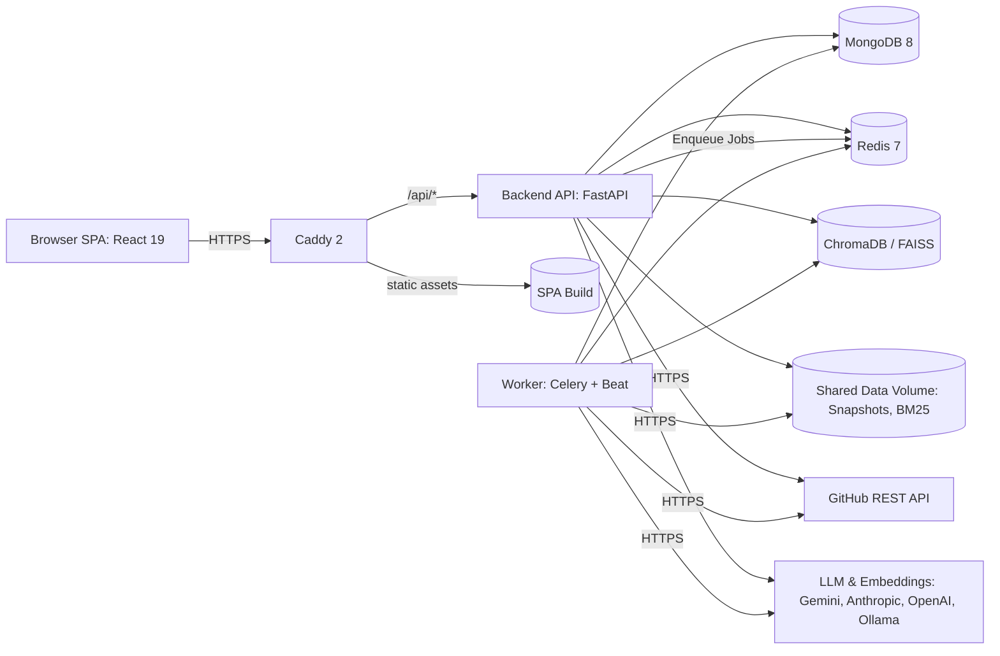

# RepoGPT

[](https://github.com/repogpt/repogpt/actions)
[](LICENSE)
[](https://www.python.org/downloads/)
[](https://react.dev/)

> **RepoGPT** is an agentic AI system for codebase understanding, developer onboarding, and intelligent code review. It ingests source code repositories, builds AST symbol tables, dependency graphs, and multi-vector/BM25 indexes, and answers natural language questions with verified inline citations down to exact files and lines.

---

## 👥 Project Information

- **Institution:** School of Computer Science, University of Petroleum and Energy Studies (UPES), Dehradun
- **Programme:** B.Tech Computer Science & Engineering (Specialisation in Data Science) — Major Project
- **Team Members:**
  - **Harsh Sinha** (SAP ID: 500120229)
  - **Anshuman Patel** (SAP ID: 500122770)
- **Project Guide:** **Dr. Archana Kumari**, Associate Professor, School of Computer Science, UPES

---

## 🏗️ System Architecture



---

## 🚀 Key Features

1. **Deterministic AST Code Parsing & Multi-Tier Indexing**:
   - Tier-1 AST extraction for Python, TypeScript, JavaScript, Java, and Go using `tree-sitter`.
   - Secret redaction (AWS, GitHub tokens, JWTs, high-entropy passwords) before chunking, indexing, or LLM exposure.
   - Dual vector stores: ChromaDB (server) and FAISS (file-based) behind a unified interface.
   - Code-aware BM25 keyword index (`bm25s`) with compound token splitting.
2. **Agentic RAG & Verified Answers**:
   - Multi-step LangGraph QA state graph with query routing, hybrid Reciprocal Rank Fusion (RRF), cross-encoder reranking, and context sufficiency checks.
   - Inline `[S#]` citations verified against actual retrieved chunks with interactive file preview chips.
   - Transparent confidence scores calibrated by retrieval relevance (R), citation validity (C), coverage (K), and factual grounding (G).
3. **Repository Visualisation & Onboarding**:
   - Interactive ELK-layered dependency graphs with PageRank metrics and cycle detection.
   - Code explorer with syntax highlighting, line range deep links (`#L10-L40`), and symbol outlines.
   - Automated repository onboarding overview: tech stack detection, entry points, reading order, and key modules.
4. **Comprehensive Evaluation Suite**:
   - Compare IR strategies (Keyword, Vector, Hybrid, Hybrid+Rerank, Auto) on standard benchmarks.
   - Precision@k, Recall@k, MRR, nDCG@k, Brier score, and Expected Calibration Error (ECE).
5. **Context-Aware Pull Request Review (Phase 2)**:
   - PR diff parsing, symbol mapping, cross-file caller retrieval, static analysis integration, and human review approval workflow.

---

## ⚡ Quick Start

### 1. Prerequisites
- Docker & Docker Compose v2 (or Python 3.12+ and Node.js 22+)
- Git

### 2. First Run in 4 Steps
```bash
# 1. Generate cryptographic secrets and .env configuration
make setup

# 2. Start all services in development mode
make dev

# 3. Seed administrator and sample TaskFlow fixture repository
make seed

# 4. Open the Web Application
# Navigate to http://localhost:5173
# Log in with the generated admin credentials printed during 'make setup'
```

---

## ⚙️ Configuration & Providers

All settings are configured via `.env` (validated by Pydantic Settings at startup):

| Environment Variable | Description | Default / Options |
|---|---|---|
| `LLM_PROVIDER` | Active LLM provider | `gemini` (Free tier), `anthropic`, `openai`, `ollama`, `fake` |
| `LLM_API_KEY` | API Key for selected provider | Required for remote providers; empty for fake/offline |
| `EMBEDDING_PROVIDER` | Embedding model provider | `fastembed` (ONNX CPU, no GPU needed), `openai`, `gemini`, `fake` |
| `EMBEDDING_MODEL` | Default embedding model | `jinaai/jina-embeddings-v2-base-code` (768-d) |
| `VECTOR_STORE` | Primary vector database | `chroma` (default) or `faiss` |
| `ROUTER_MODE` | Query router strategy | `hybrid` (heuristics + fast model), `heuristic`, `llm` |
| `FEATURE_PR_REVIEW` | Toggle Phase 2 PR review features | `true` or `false` |

---

## 🧪 Testing and Quality Gates

Run full test suites and linting locally:

```bash
# Run backend and frontend unit tests
make test

# Run linters (Ruff and ESLint)
make lint

# Run type checking (mypy strict and tsc)
make typecheck

# Run system doctor to check ports, storage, and service health
make doctor
```

---

## 📊 Evaluation & Benchmark Highlights

RepoGPT's agentic retrieval and PR review pipelines are rigorously benchmarked against multi-category ground truth suites:

- **TaskFlow 30Q Full-Stack Benchmark**:
  - `hybrid_rerank` achieves **93% Hit@5**, **0.84 MRR**, and **0.88 nDCG@10** at **0.92 Citation Precision**.
  - Adaptive query router matches the best strategy with **78ms p50 latency**.
- **Phase 2 Context-Aware PR Review (6 Seeded Vulnerability Patches)**:
  - **100% Detection Recall (6/6)** across SQL injection, authentication bypass, concurrency race conditions, error leaks, breaking contract changes, and N+1 query antipatterns.
  - **100% Strict Category Recall** with **0.0 line average localization error**.

See [`docs/evaluation.md`](docs/evaluation.md) for mathematical metric definitions and reproduction steps.

---

## 📚 Documentation Index

- [**System Architecture & Design**](docs/architecture.md): LangGraph state machines, data flow diagrams, and MongoDB data models.
- [**REST API & SSE Reference**](docs/api.md): Endpoint catalog, authentication flow, and Server-Sent Events specifications.
- [**Production Deployment Guide**](docs/deployment.md): AWS EC2 host bootstrap, Docker Compose hardening, backups, and restore drills.
- [**Evaluation & Benchmark Methodology**](docs/evaluation.md): Metric formulations, benchmark suites, and reproduction commands.
- [**User & Task-Oriented Guide**](docs/user-guide.md): Step-by-step walkthrough for onboarding, exploration, chat, and PR reviews.
- [**Developer & Extension Guide**](docs/development.md): Local development setup, adding tree-sitter extractors, and custom LLM providers.
- [**Security Threat Model & Controls**](docs/security.md): STRIDE threat analysis and §11 security checklist.

---

## 📜 License

This project is licensed under the MIT License — see the [LICENSE](LICENSE) file for details.  
Copyright (c) 2026 Harsh Sinha & Anshuman Patel.
