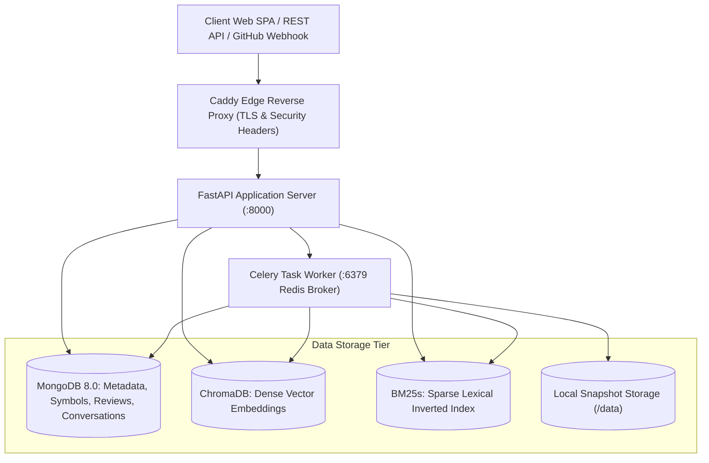
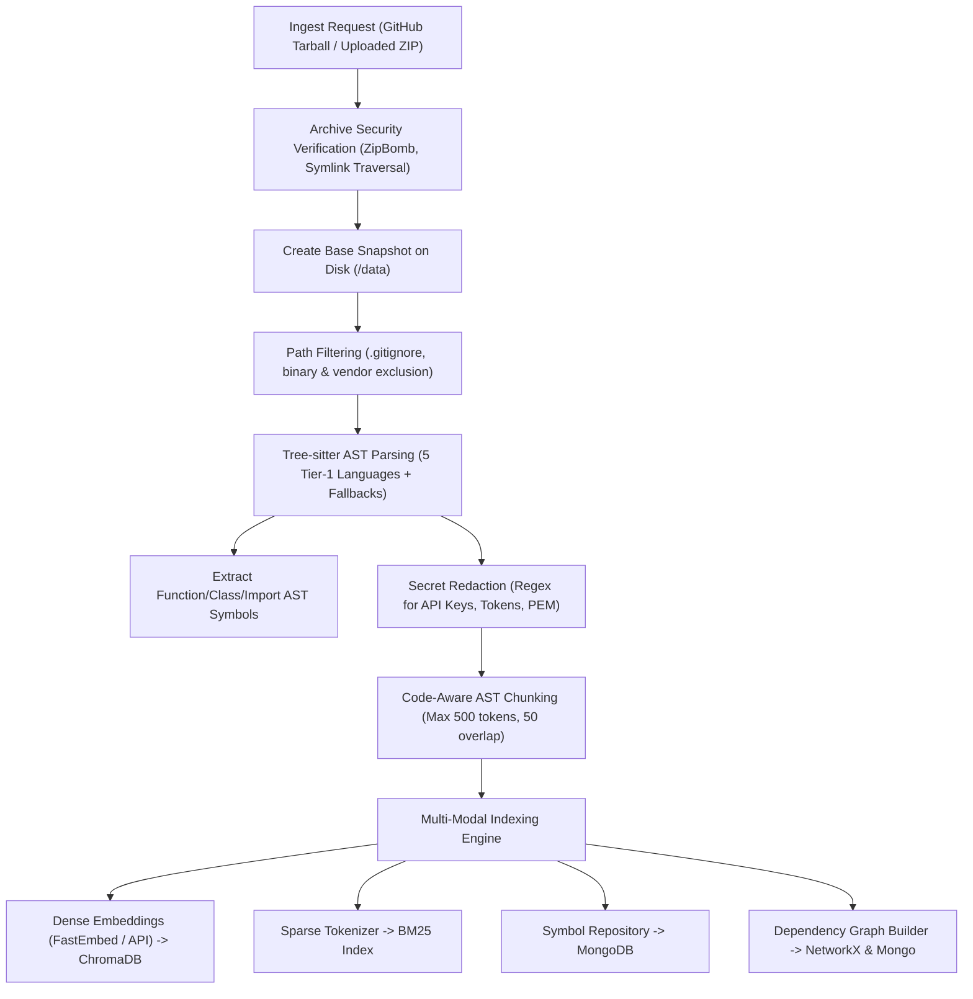
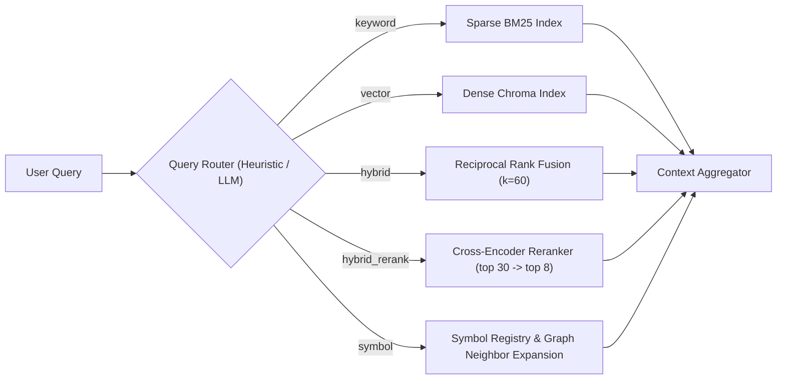
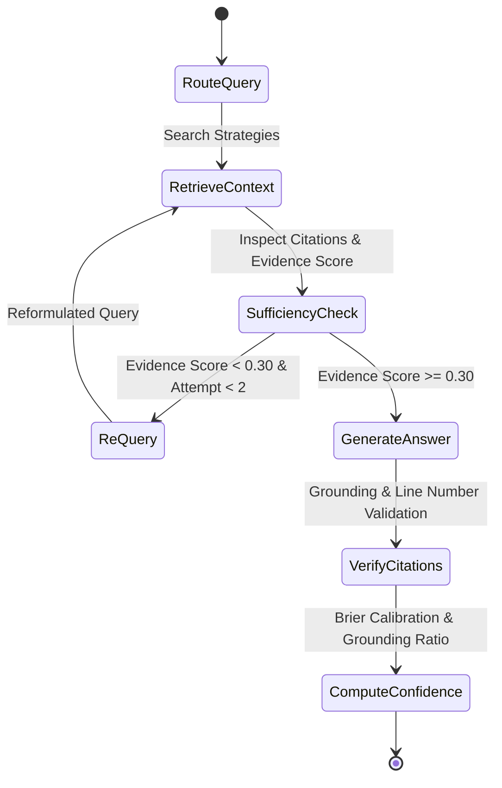
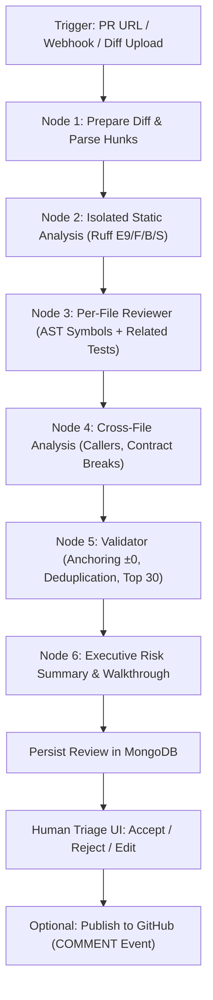

# RepoGPT — System Architecture & Technical Design

This document details the architectural design, component interactions, agentic workflows, data pipelines, and database schemas of **RepoGPT** per §3, §6, §8, §9, and §10 of the system specification.

---

## 1. System Overview

RepoGPT is an agentic AI system designed for repository-level code understanding, developer onboarding, and context-aware code review. The platform combines deterministic static code analysis (tree-sitter AST parsing, NetworkX call graphs, isolated Ruff linter) with adaptive multi-stage neural retrieval (Reciprocal Rank Fusion, cross-encoder reranking, HyDE) and LangGraph agentic state machines.

---

## 2. Ingestion, Parsing & Indexing Pipeline (§8)

### 2.1 Archive Security & Path Normalization
- **Strict Path Traversal Protection**: Archives are validated prior to extraction; paths resolving outside the target sandbox or containing symlinks pointing outside target directories are rejected.
- **Decompression Bomb Defense**: Uncompressed archive size is limited to 200 MB and maximum file count capped at 10,000 files.

### 2.2 AST Symbol Extraction via Tree-sitter
`ParserRegistry` dynamically loads pinned tree-sitter grammars for:
- Python (`tree-sitter-python`)
- TypeScript / TSX (`tree-sitter-typescript`)
- JavaScript / JSX (`tree-sitter-javascript`)
- Go (`tree-sitter-go`)
- Rust (`tree-sitter-rust`)

Extracted symbols record name, kind (`function`, `class`, `interface`, `method`), start line, end line, and signature.

---

## 3. Retrieval & Routing Engine (§9.1, §9.2)

RepoGPT implements a 5-strategy adaptive retrieval engine:

### 3.1 Reciprocal Rank Fusion (RRF) Formula
Matches from BM25 and vector stores are unified using the standard RRF scoring formula:
$$RRF(d) = \sum_{m \in M} \frac{1}{k + r_m(d)}$$
where $k = 60$ and $r_m(d)$ is the 1-based rank of document $d$ in system $m$.

---

## 4. Agentic QA LangGraph Workflow (§9.3)

The interactive chat and answering pipeline is orchestrated as a state machine in LangGraph:

### 4.1 State Machine Stages
1. **`RouteQuery`**: Categorizes query intent into `locate`, `explain`, `flow`, `architecture`, `dependency`, or `config`.
2. **`RetrieveContext`**: Gathers candidate code chunks capped by token budget (6,000 tokens).
3. **`SufficiencyCheck`**: Evaluates whether retrieved evidence directly addresses the question. If score < 0.30, triggers automated re-querying.
4. **`GenerateAnswer`**: Emits streamed markdown with strict `[S#]` inline citations.
5. **`VerifyCitations`**: Validates each citation against actual file existence and line boundaries.
6. **`ComputeConfidence`**: Assigns calibrated 0.0–1.0 confidence score.

---

## 5. Context-Aware Code Review Pipeline (§10)

Phase 2 PR Review is implemented as an independent LangGraph workflow (`review_graph.py`):

---

## 6. Data Model Hierarchy (§6)

The system relies on MongoDB 8.0 for schema-validated collections:

| Collection | Key Fields | Indexes |
|---|---|---|
| **`users`** | `_id`, `email`, `password_hash`, `role`, `github`, `quotas` | `email` (unique), `github.id` |
| **`repositories`** | `_id`, `name`, `owner_id`, `default_branch`, `status`, `stats` | `owner_id`, `name` |
| **`snapshots`** | `_id`, `repo_id`, `commit_sha`, `file_count`, `created_at` | `repo_id`, `commit_sha` |
| **`files`** | `_id`, `repo_id`, `path`, `language`, `line_count`, `content` | `(repo_id, path)` (unique) |
| **`symbols`** | `_id`, `repo_id`, `path`, `name`, `kind`, `start_line`, `end_line` | `(repo_id, path)`, `(repo_id, name)` |
| **`reviews`** | `_id`, `repo_id`, `status`, `risk_level`, `findings`, `walkthrough` | `repo_id`, `created_at` |
| **`conversations`**| `_id`, `repo_id`, `user_id`, `title`, `created_at` | `(repo_id, user_id)` |
| **`messages`** | `_id`, `conversation_id`, `role`, `content`, `citations`, `confidence` | `conversation_id`, `created_at` |
| **`eval_runs`** | `_id`, `benchmark_id`, `status`, `strategy_metrics`, `duration_ms` | `benchmark_id`, `created_at` |
